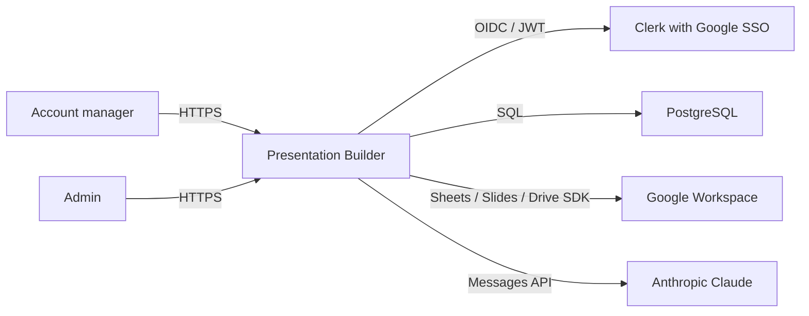
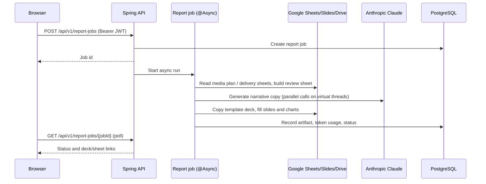

# AIAE Presentation Builder Architecture Overview

This is the canonical description of the product's implemented architecture and
the home of every fact that is specific to this repository. `CLAUDE.md` and
`.claude/` are the shared AiDigital engineering contract, installed and
checksummed by the AIAE template (`.claude/.aiae-fixtures-manifest`) — **do not
edit them in this repository**; put project facts and project-specific
constraints here instead. When a shared doc says "discover the repository's …",
the answer is in this file.

Update this file in the same change whenever a runtime boundary, module,
data flow, integration, deployment model, or cross-cutting concern changes.

## Document status

- Owner: AIAE Presentation Builder engineering team
- Lifecycle phase: MVP
- Last verified against: branch `PDI_240`, 2026-11-12
- Verification evidence: `bash scripts/local-verify.sh`, `bash scripts/gates-report.sh`
- Cache status: disabled
- MVP usage telemetry: enabled during MVP

"Cache status: disabled" refers to the optional distributed
`backend/cache-management` module, which this project does not have. A single
in-process Spring cache exists; see [Caching and consistency](#caching-and-consistency).

## Product and system context

A report constructor for AI Digital account managers. It reads a campaign's
media plan, Elevate delivery data and optional paid-media exports, builds a
reviewable Google Sheet, and generates end-of-campaign (EOC) and end-of-month
(EOM) Google Slides decks with AI-written narrative copy. Two deck designs
exist: **Standard** and **MPO** (`TemplateVariant`).

The application is a React single-page application backed by a Spring Boot
API. The browser uses `BrowserRouter`; application routes resolve through the
SPA fallback (`SpaFallbackController`) when the built frontend is served by
Spring Boot.

## Product-specific evidence

- Product capability: Generate EOC/EOM Google Slides decks (Standard and MPO designs) and a reviewable Google Sheet from a campaign media plan and delivery data, with Claude-written narrative copy.
- Primary users: AI Digital account managers; admins use the usage and failure dashboard.
- Primary production flow: The user selects source sheets, the backend reads and matches line items, an async report job builds the review sheet and deck, and the user opens or resumes the result from My Reports.
- Evidence path: `backend/service/src/main/java/com/aidigital/reportconstructor/service/reports/services/impl/ReportGenerationServiceImpl.java`
- Evidence path: `backend/application/src/main/java/com/aidigital/reportconstructor/controllers/ReportJobsController.java`
- Evidence path: `frontend/src/features/report-constructor`

## Runtime and deployment

| Environment | Frontend | Backend | Data |
|---|---|---|---|
| Local development | Vite on 5173 (`strictPort`), proxies the API to `BACKEND_DEV_PORT` (default 5000) | Spring Boot on 5000 (`scripts/local-dev-backend.sh`); `application.yml` falls back to 8080 only when `PORT` is unset | Local PostgreSQL |
| Replit development | Vite dev server (`scripts/replit-dev-frontend.sh`) | Spring Boot on 5000 (`scripts/replit-dev-backend.sh`, profile `replit`) | Replit PostgreSQL |
| Replit deployment | Built SPA served by Spring Boot | Reserved VM (`gce`), external port 80 → 5000 | Replit PostgreSQL |
| DEV / PROD (AWS) | Built SPA served by Spring Boot | Container image in ECR, Helm chart `aiae-presentation-builder-api`, published through GitOps (`scripts/gitops-publish.sh`) | Managed PostgreSQL |

- DEV deploys on push to the numbered release branch that equals the
  `DEV_DEPLOY_BRANCH` environment variable (`.github/workflows/deploy-dev.yml`).
  PROD is a manual `release-prod.yml` dispatch whose `release_version` must
  equal the branch; `rollback-prod.yml` reverts.
- Deck/sheet template ids come from `application.yml` defaults, overridden
  locally by `backend/.env.local`. Never print that file: it holds the Google
  service-account key.
- Evidence: `.replit`
- Evidence: `.github/workflows/deploy-dev.yml`

## Repository and module boundaries

Production package root: **`com.aidigital.reportconstructor`** — one root
across all modules. Maven modules (`backend/pom.xml`), in build order:

| Area | Responsibility | May depend on |
|---|---|---|
| `frontend/` | React UI, routing, Clerk auth integration, typed API consumption | Generated OpenAPI types and the shared API client (`frontend/src/shared/api`) |
| `backend/domain` | JPA entities and repositories (`ReportJobEntity`, `AdminUserEntity`, `ClaudeUsageEventEntity`, `UsageDailyEntity`) | Persistence APIs only |
| `backend/migrations` | Liquibase changelogs | No production Java modules |
| `backend/observability` | `ExternalClientMetricsInterceptor` and `ExternalCallTimer` (`observability.external`), recording `external.client.requests` tagged `client` / `operation` / `outcome` | Metrics APIs only |
| `backend/event-logging-to-db-feature` | Temporary MVP feedback telemetry (`usage_events`); removed at engineering handoff | Application service annotations and PostgreSQL during MVP only |
| `backend/service` | Report engine, sheet/deck orchestration, admin statistics, entity services | `domain`, outbound integration ports |
| `backend/external-services` | Outbound integrations: `anthropic`, `google`, `clerk`, `common.http`; implements the ports in `service` | `service` (ports, their request/result types, `admin.services.AdminEmailDirectory`), `observability`; never `domain` |
| `backend/application` | Runtime composition, security, OpenAPI controllers, exception translation, Logbook, SPA hosting | `service`, `external-services`, `observability` |

**Module direction (decision D6, deliberate divergence).** The standard wants a leaf
`external-services` with `service → external-services`. Here the outbound ports live in `service`
(`service.reports.ports`) and `external-services` implements them, so the arrow points the other way
and `application` depends on `external-services` to put the adapters on the classpath. The rule
kept regardless: `external-services` never depends on `domain` or on entity/admin services — data it
needs from the business side arrives through a narrow `service` interface (e.g. Drive auto-share
reads admin emails via `AdminEmailDirectory`). Converging is planned one provider per branch, in the
onboarding-platform shape (provider-level client + `model/` records, `service` maps): Clerk, Drive,
Sheets, then Claude and Slides.

Converted providers follow `externalservices/<provider>/`: `<Provider>Client` (interface, provider
terms only), `<Provider>ExternalException`, `impl/<Provider>ClientImpl`, `model/` records, and
`config/<Provider>Properties` + `<Provider>Config`; these packages import nothing from `service`.
The port implementations that translate between a `service` port and a provider client live in
`externalservices/bridge/` — the only place a converted provider meets `service` types. When every
provider is converted, the bridges move into `service` and the module edge flips.

- Converted: **Clerk** (`ClerkClient.googleOAuthAccessTokens` → `bridge.ClerkUserGoogleTokenProvider`
  implements `UserGoogleTokenProvider`; both beans exist only when `app.clerk.secret-key` is set,
  otherwise callers use the Google service account).
- Not yet converted: `google` (Drive, Sheets, Slides, charts), `anthropic`.

Controllers implement generated OpenAPI interfaces and delegate to services.
Repositories are accessed only through their paired entity services.

Frontend layout:

- Navigation shell is a **top header**: `frontend/src/app/AppShell.tsx` renders
  `frontend/src/shared/ui/AppHeader.tsx` ("Elevate layout, no left sidebar")
  above a centered content area. There is no left-nav shell and no
  `features/layout`; preserve the header unless the product owner asks
  otherwise.
- Feature areas: `frontend/src/features/report-constructor`, `my-reports`,
  `admin-dashboard` (`_template` is scaffold).
- Design tokens: `frontend/src/shared/ui/base/tokens.css` and
  `frontend/src/shared/ui/aidigital-tokens.css` (loaded from
  `app/AppLayout.tsx` / `main.tsx`). Token families defined here: `--primary`,
  `--background`, `--foreground`, `--accent*`, `--surface-*`, `--text-*`,
  `--border*`, `--radius-sm|md|lg|xl|full`, `--space-*`, `--status-*`,
  `--chart-*`, and the report-constructor palette `--rc-*`. Where the shared
  `frontend_style.md` token tables use other names, use these real names.
- Frontend CSS is `rem`-only and has no hex literals: the token files define colours as
  `rgb(r g b)`, components use the tokens. `shared/ui/base/reset.css` makes every `<button>`
  centred `inline-flex`; a button with stacked or left-aligned content sets its own `display` /
  `justify-content` in its class (e.g. `.rc-typecard`, `.ad-range__preset`).

- Evidence: `backend/pom.xml`
- Evidence: `frontend/src/app/AppShell.tsx`

## Primary runtime flows

### Report generation

- Jobs can be resumed from an existing sheet (`/reports/{jobId}/resume`,
  `/reports/adopt-sheet`) or dismissed. Failures are caught on the async thread
  and recorded on the job; admins see them under `/admin/failures`.
- `UsageRollupRefresher` rebuilds the `usage_daily` rollup every 10 minutes
  (`@Scheduled`), which feeds the admin dashboard.
- `ReportGenerationServiceImpl` only enqueues, opens the run's usage/failure scopes and picks a workflow:
  `DirectReportWorkflow` (from the request's grids) or `SlidesFromSheetWorkflow` (from a reviewed
  workbook), both in `service.reports.helpers` with their collaborators (`BreakdownSectionWorkflow`,
  `MpoDeckTokenWriter`, `ClaudeCallDispatcher`, `ReportTokenAssembler`, `ReportRunRecorder`).
- Evidence: `backend/service/src/main/java/com/aidigital/reportconstructor/service/reports/services/impl/ReportGenerationServiceImpl.java`
- Evidence: `backend/service/src/main/java/com/aidigital/reportconstructor/service/reports/helpers/SlidesFromSheetWorkflow.java`
- Evidence: `backend/service/src/main/java/com/aidigital/reportconstructor/service/admin/UsageRollupRefresher.java`

## API and security boundaries

- OpenAPI contract: `backend/application/src/main/resources/api/v1/specs/openapi.yaml`.
  Generated server sources live under `backend/application/target/generated-sources`
  and generated frontend types in `frontend/src/shared/api/generated/schema.d.ts`
  (`npm run generate:api`). Never edit either.
- Resource groups: `auth/me` (bootstrap), `sheets`, `google/status`,
  `line-items/match`, `placeholders`, `report-jobs`, `reports`, `admin/*`,
  `version`.
- Clerk with Google SSO authenticates users; the backend validates JWT issuer,
  signature, authorized party and the company email domain
  (`CompanyEmailDomainAuthorizationManager`, `ClerkJwtClaimsValidator`).
- Admin authorization: `AdminAccessPolicy` — an email is admin when it is on the
  configured allow-list (root admins) or has a UI-managed grant
  (`admin_users`). Comparisons are case-insensitive.
- Secrets stay in Replit Secrets, `backend/.env.local`, or the deployment
  secret manager; never in frontend code or public env vars.
- Evidence: `backend/application/src/main/java/com/aidigital/reportconstructor/security/SecurityConfig.java`
- Evidence: `backend/service/src/main/java/com/aidigital/reportconstructor/service/admin/AdminAccessPolicy.java`

## Data ownership and migrations

- PostgreSQL is the system of record for report jobs, admin grants, Claude
  token usage, the daily usage rollup, and MVP usage events. Generated decks
  and sheets are owned by Google Drive; the database stores their ids/links.
- Liquibase changelogs: `backend/migrations/src/main/resources/db/changelog`
  (master `db.changelog-master.xml`, change sets under `changes/`,
  `0001`–`0011`). Shared docs that say `backend/db` mean this path. Never rename
  the changelog directory or rewrite an applied changelog.
- Evidence: `backend/migrations/src/main/resources/db/changelog/db.changelog-master.xml`

## Caching and consistency

- One in-process Spring cache, `adminStats` (`AdminStatsCache`), enabled by
  `CacheConfig` with Spring Boot's default simple in-memory manager — no
  provider dependency. It holds one admin-dashboard snapshot per date window and
  is evicted when `usage_daily` is rebuilt, not by TTL.
- The cache is per instance. A second instance can serve a snapshot at most one
  rollup interval old; this is accepted for an admin dashboard. There is no
  `backend/cache-management` module.
- Evidence: `backend/application/src/main/java/com/aidigital/reportconstructor/config/CacheConfig.java`

## External integrations

| Integration | Purpose | Protocol/authentication | Failure and retry policy |
|---|---|---|---|
| Clerk | User authentication; OAuth token access (`externalservices.clerk`) | OIDC/JWT; Clerk secret key | Fail closed on token validation; 15 s response timeout on Clerk API calls |
| PostgreSQL | Application persistence | JDBC | Transaction rollback; bounded Hikari pool |
| Google Sheets / Slides / Drive | Read source sheets, build review sheet, copy and fill deck templates, charts, sharing (`externalservices.google`) | Google SDK with a service account | Every call through `GoogleCallTimer`, directly or per attempt via `GoogleRequestRetrier`, tagged `google-sheets|slides|drive` + operation |
| Anthropic Claude | Narrative copy, digests, grounding/figure checks (`externalservices.anthropic`) | HTTPS Messages API; API key | Pooled client per per-call response timeout; token usage recorded per job |

- Spring HTTP clients come only from `PooledRestClientFactory`
  (`externalservices.common.http`): bounded Apache HttpClient 5 pool per client,
  explicit timeouts from `app.external.http.*`, metrics and Logbook interceptors.
- Evidence: `backend/external-services/src/main/java/com/aidigital/reportconstructor/externalservices/common/http/PooledRestClientFactory.java`
- Evidence: `backend/external-services/src/main/java/com/aidigital/reportconstructor/externalservices/google/GoogleCallTimer.java`

## Observability and operations

- Structured logs to stdout with a correlation id.
- Actuator health and Prometheus metrics; outbound calls on the
  `external.client.requests` timer.
- Logbook HTTP logging (inbound and outbound) is metadata-only by default
  (`app.logbook.include-bodies: false`); `Authorization`, `X-API-Key` and similar
  headers are masked.
- Admin dashboard (`/api/v1/admin/stats`, `/admin/failures`, `/admin/reports`)
  shows usage, token cost and failed jobs.
- Evidence: `backend/application/src/main/java/com/aidigital/reportconstructor/config/LogbookConfig.java`

## Build and test facts

- Run Maven from `backend/` (Checkstyle resolves its suppressions file relative
  to the working directory). Checkstyle (`backend/config/checkstyle.xml`):
  LineLength 120 (tab width 4), FileLength 2700. `ClaudeBatchPromptBuilder.java`
  sits at the FileLength limit — grow it only by moving code out.
- Production code never calls `now()`: inject `service.common.time.CurrentTime`
  (UTC). Static methods on beans/enums are replaced by small `@Component`
  resolvers (e.g. `NarrativeCopyLimitsResolver`).
- `mvn verify` enforces Maven dependency analysis in every module: declare the
  libraries a module compiles against, keep starters at `runtime` in
  `application`. Policy and allowlist: `backend/DEPENDENCY-ANALYSIS.md`.
- Backend tests: JUnit 5 + Mockito unit tests per module, MVC/controller tests
  in `application`. There is **no `*IT` integration-test layer**.
- Frontend: Vitest + Testing Library (`npm test`), `npm run typecheck`,
  `npm run lint`, `npm run build`.
- Lint: ESLint 9 flat config `frontend/eslint.config.js` (typescript-eslint,
  local rule `project-rules/import-section-order` in `frontend/eslint-rules/`,
  `no-restricted-syntax` ban on inline `interface`/`type` and top-level `const`
  in `src/**/*.tsx`, tests included — mocks and fixtures live in
  `features/*/testing/*.ts`). Zero errors is the baseline; never disable rules.
- Pre-commit: Husky 9 (`.husky/pre-commit` runs `npm --prefix frontend run lint`),
  installed by the frontend `prepare` script (`scripts/prepare-husky.mjs`).
- Full local verification: `scripts/local-verify.sh` (backend `mvn test`,
  frontend `npm ci`, `generate:api`, `typecheck`, `lint`, `build`), followed by
  the report-only AIAE gate run `scripts/gates-report.sh`.

## Decisions, constraints, and known risks

| Decision or constraint | Reason | Consequence / follow-up |
|---|---|---|
| Contract-first OpenAPI | One backend/frontend API contract | Generated sources must not be edited |
| BrowserRouter + top-header shell | Elevate layout, direct links | SPA fallback must stay; do not introduce a sidebar |
| `CLAUDE.md` and `.claude/{rules,agent_docs,skills}` are AIAE-managed | Template upgrades refuse to overwrite locally edited fixtures | Project facts live in this file; upgrade by re-running the standard's `install-claude-fixtures.sh` |
| AIAE gates are report-only (`scripts/gates-report.sh`) | Phase 1 of the AIAE convergence: measure first | Failing gates are a backlog, not a blocker, until a later phase makes them blocking |
| Liquibase `preConditions` on every changeSet | Shared rule | `0001-usage-events.xml` and `0002-report-jobs.xml` predate it; every **new** changeSet declares them; never rewrite applied changelogs |
| BigQuery query rules (`13-bigquery.md`) | Shared rule | No BigQuery code; delivery data arrives through exported Google Sheets (Elevate). Applies only if BigQuery access is added |
| GSD workflow (`skill-selection.md`) | Shared rule | GSD is not installed; use `task-workflow` and the focused skills |
| Shared rules this project does not meet yet | Code predates the contract | Apply the rule to **new** code; do not retrofit existing code as a side effect of unrelated work — raise it as its own task |
